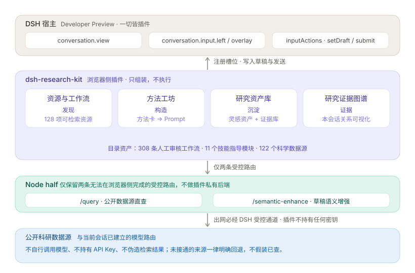
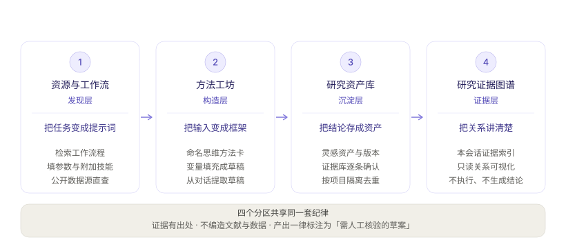
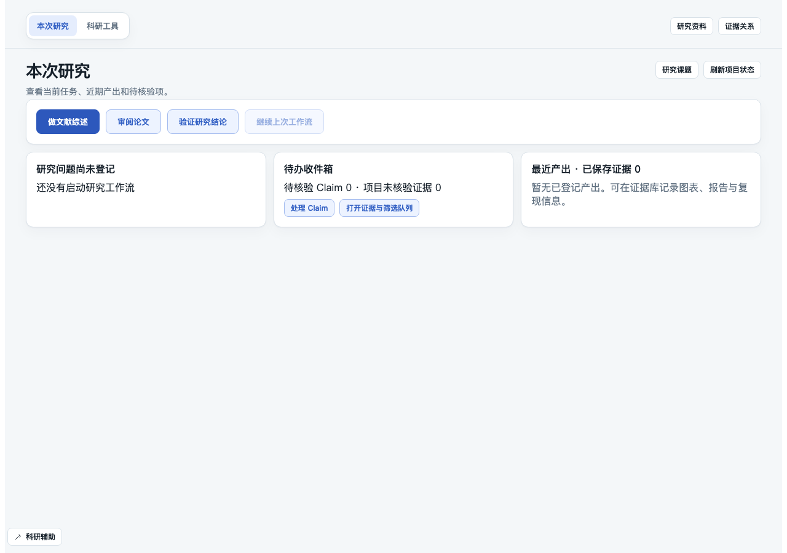
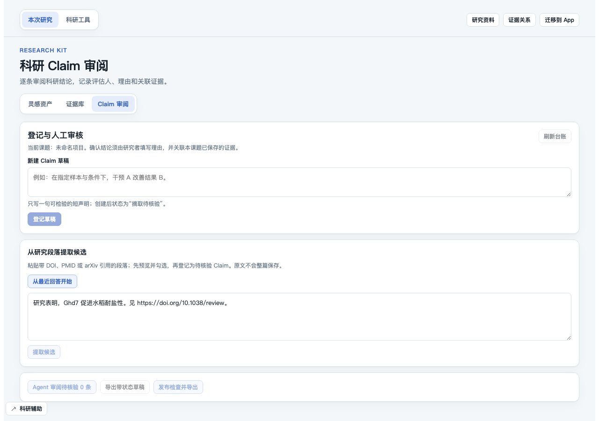
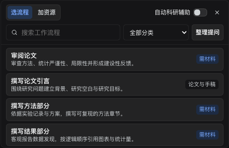

# DSH Research Kit

[](LICENSE)
[](https://github.com/fsrmqi/dsh-research-kit/actions/workflows/ci.yml)
[](https://github.com/topics/dsh-plugin)
[](https://nodejs.org)
[](https://dshhub.org/plugins/fsrmqi/dsh-research-kit)

[English](README.en.md) · [简体中文](README.md)

> A research workbench and cross-host MCP toolset for DeepSeek Harness: 351 human-reviewed workflows, 109 skill entries, 129 scientific data sources, and 36 research tools.

It turns recurring research tasks — peer review, writing an introduction, literature synthesis, planning a statistical analysis — into **parameterized, editable prompts that you review before sending**. The plugin only assembles the task and hands it back to your session; execution stays with your own DSH agent. The DSH workbench needs DSH, while the standalone stdio MCP Server can be attached to Codex, Claude Code, Zed and other compatible hosts. All research judgments still require verification by the researcher.

---

## Prerequisite: what is DSH?

This project is a plugin for [DeepSeek Harness](https://github.com/deepseek-ai/deepseek-harness) (CLI name `dsh`), an open-source local agent harness by DeepSeek built around one idea: *Everything is a Plugin* — models, tools, UI and storage are all replaceable plugins.

**The DSH workbench needs DSH; the MCP Server runs independently.** It ships no model or API key — the DSH side reuses the current session's model routing, and the MCP side runs as a local stdio service.

| What you need | Where to get it |
| --- | --- |
| DSH itself | [deepseek-ai/deepseek-harness](https://github.com/deepseek-ai/deepseek-harness) · [official site](https://deepseek.com/harness) |
| Plugin ecosystem | [GitHub topic: dsh-plugin](https://github.com/topics/dsh-plugin) |
| Node.js | `>= 22.19` |

> DSH is currently a **Developer Preview** and will iterate quickly, possibly with breaking changes. The `conversation.view` slot and the `inputActions` contract evolve with DSH versions — after upgrading DSH, re-run the [manual QA checklist](https://github.com/fsrmqi/dsh-research-kit/blob/main/docs/MANUAL-QA.md).

## The problem it solves

Generic chat input suits ad-hoc questions, not recurring research tasks with defined steps, material requirements and quality boundaries. Reviewing a paper, writing an introduction, running a literature synthesis or planning an analysis all need four things:

1. **Explicit** input materials and output scope;
2. **Auditable** steps instead of one vague instruction;
3. **Human review before send** — you see, edit and confirm the task description;
4. **Hard rules** against fabricated citations, data and conclusions.

Research Kit turns those four into reusable assets.

## How it works

```text
Research capability catalog (589 entries)
  → pick a workflow
  → fill parameters, reference materials via @file
  → review and edit the final prompt
  → write to composer, or send to the current session
  → executed by the current DSH session's agent and its configured tools
```



Deliberate trade-offs:

- **No model calls, no stored keys.** Execution belongs entirely to the current session;
- **No file-upload reimplementation.** Materials use DSH's native `@file` mentions;
- **No pretending to have retrieved anything.** Database entries state their access prerequisites honestly and fall back to Agent/MCP explicitly.

## Capabilities

**🧪 351 human-reviewed research workflows**
Across 28 workflow families — paper & manuscript, literature research, data analysis, genomics, clinical research, neuroscience, ecology, astronomy & space and more — maintained as per-family shards under `catalog/workflows/`. Each is a parameterized, editable prompt template with built-in anti-fabrication boundaries (never invent citations, data, page numbers or authorial intent) and explicit "draft pending human verification" framing.

**⏲ Timed decisions and evidence review**
The Timed research decision and Pending-evidence review reminder workflows state their capability prerequisites inside the workflow instructions, leaving the decision to the current Agent: a timed question is issued only when the Agent Preset actually enables `ask_user_question` in timed mode, and a review reminder is created only after explicit confirmation when `schedule_create` is actually available — otherwise they output a copyable reminder body without claiming it was created. The plugin itself does not probe for either host capability and does not decide whether the Agent calls them. Neither workflow treats a timeout or `pending` as approval, nor automatically publishes, deletes, or promotes research assets.

**🧩 109 skill entries: 46 guidance modules + 63 capability entries**
Guidance modules work as prompt guidance — scientific writing, statistics review, citation hygiene, evidence synthesis, reproducibility, review ethics & confidentiality, data integrity, uncertainty communication, plus method modules for experimental design, hypothesis generation, scientific brainstorming, critical thinking, statistical power, systematic literature review, scientific visualization, uncertainty & units, clinical report drafts, venue compliance, peer-review comments, and grant writing, and three domain modules: agricultural experiment design, crop genomics & breeding evidence, and bioinformatics workflow governance — toggled at launch to fold into the workflow prompt. Capability entries are catalogued under an honest "requires host capability" status — bulk RNA-seq, Nextflow, Benchling/DNAnexus integrations, literature API search, docx/pdf production and other execution-side skills — stating the required toolchain, credentials and data-egress boundaries with a pre-use checklist; they inject no prompt fragment and execute nothing themselves.

**🔬 129 scientific data sources, 11 of them queryable in-plugin**
Literature, clinical, genetics, omics, protein/chemistry — plus astronomy & space, biodiversity, climate & environment, geospatial. Public APIs return candidate records with links and stable identifiers; rate-limited, licensed or parameter-heavy sources fall back explicitly to the DSH agent / MCP.

**✍️ Fully visible and editable before send**
Parameter substitution updates the preview live. After manual edits, later parameter changes never silently rewrite the body, and a "restore generated prompt" action is one click away. Missing required parameters block sending.

**🧭 One workbench, two main entries**

| Entry | Common actions |
| --- | --- |
| This Research | See current tasks, pending verification and recent outputs; open Research Materials to manage assets, evidence and claims, and Evidence Relations to trace links |
| Research Tools | Pick a workflow to assemble a prompt; use a method card to extract from the current conversation; look up a data source directly or delegate to the Agent; My Space keeps reusable private methods and workflow templates |

Inside the workbench the layout is Project Home plus four loop sections — discover, construct, deposit and evidence — sharing one anti-fabrication and human-verification discipline.



Beyond performance, search, evidence pagination, literature interoperability and the unified Claim ledger, [Optimizations & feature notes](https://github.com/fsrmqi/dsh-research-kit/blob/main/docs/PRODUCT-IMPROVEMENTS.md) documents review-record export (`links[].evidenceId` maps to the candidate list `id`) and per-stance evidence lookup for claims (Chinese only).

**⏱ Assembly replay: see how the prompt was put together**
After you launch a workflow, the workbench replays the **actual assembly facts** from `composeWorkflow` segment by segment — workflow → parameters → attached skills → database boundaries → human verification — and every segment can be located as an anchor in the generated prompt text, so the replay and the prose corroborate each other. A compact replay is embedded in the detail pane; "Open replay window" launches the standalone archify interactive viewer (four visual presets, chapter narrative, semantic lens, radar overview). The replay shows **assembly actions that already happened** — it predicts no execution result and means no tool was run. Under `prefers-reduced-motion` it degrades to a static view.

`research_run_export` also returns `release_evidence`: a run-snapshot reference containing no local paths or passport body, with a run ID and content hash that other controlled asset systems can use to associate a publication record. Its `verification_status="snapshot_exported"` means only that the passport was exported — **not** that a research conclusion, workflow or Skill passed verification. Publishing high-impact assets still requires separate real-task verification evidence and human confirmation.

**Research Claims and Context Packs**: the MCP server exposes an explicit Claim ledger. Every Claim carries an epistemic status — `extracted`, `inferred`, `ambiguous`, `verified` or `rejected` — and `verified` requires a human-supplied evidence ID, operator and rationale. `research_run_checkpoint_approve` can attach verification receipts; `research_context_pack` projects only Claims, evidence metadata and human receipts for review before injection, never rewriting unconfirmed conclusions as facts or carrying full papers, notes or search terms.

<details>
<summary><strong>More capabilities</strong> (click to expand)</summary>

- **Science mode presets** — one-click bundles: **General research, Literature & papers, Bioinformatics, Crop breeding, Clinical & population research, Data analysis & visualization**. Each attaches a matching skill set and research discipline (pipeline versioning and QC traceability, agricultural trials and G×E boundaries, privacy and bias, statistical prerequisites and chart interpretability, and so on). Presets are guidance bundles, not capability switches — nothing auto-executes.
- **Composer quick entry** — click "Research Assist" in the composer toolbar to pick a workflow, add resources or tidy the current question. The automatic-assist toggle in the overlay header is off by default and scoped to the current session; when enabled it suggests short research steps from the draft, attached materials and the most recent question only on an explicit continuation, and inserts them after you confirm. The same toggle surfaces save suggestions beside eligible answers — nothing enters the vault until you check and confirm.
- **Draft enhancer** — open it from "Research Assist → Tidy question": a lightweight tier (zero-token structuring) and a semantic tier (reuses the current session model, streams, five-dimension diagnosis, cancellable), with three strength levels; enhanced drafts can be undone and compared with the original. Selecting text replaces only the selection; if the draft changes during async work the write is rejected, and a selection containing `@` chips asks for whole-draft enhancement because coordinates do not line up. The semantic tier can optionally search a host-connected Memory Center MCP via the "project memory" toggle (retrieve → preview sources → user opts in → assemble; off by default, never silently injected). The entry form is switchable in the Plugins detail page ("Runtime status"): **in-composer** (default) or **floating companion** (draggable, remembers its spot, plus the deposit companion button) — changes apply instantly, no restart.
- **Host capability probe** — the database detail panel shows one line of deployment-level facts: which of Web / Shell / filesystem / model routing are composed, and which MCP servers are actually connected (parsed from the tool registry, bounded). Facts only — it never claims a database is usable and never rewrites catalog labels.
- **Answer evidence** — open the preview from a completed answer to review each key finding alongside its cited paper, figure or section, and any missing material. Select items and confirm to save them as pending verification. The graph can reopen the paper and show the saved source location.
- **Manual deposit** — open an answer's preview from the action row below it, then check the findings you want and save them.
- **Safe draft insertion** — async results use the newer DSH `captureInsertion()` / `insertText()` contract to insert at the caret with a draft-revision check. If the host lacks it, the plugin falls back to replacing the draft; when the user's newer draft would be overwritten, it asks for a manual paste instead.
- **Plugins-page status** — the Research Kit detail page reports Web / Shell / FS / LLM composition facts, connected MCP servers, and the number of direct-query adapters; a title badge shows the build-time workflow / skill / data-source scale (no runtime probe, so it never flashes a zero first), and the head "Copy diagnostics" action writes the plugin version, catalog scale and that probe result to your local clipboard (never uploaded, no session content). The head also offers "Back to conversation": one click returns the main area to the current conversation, restoring the research workbench view only when that session was left on it (the tab is host-owned session state; there is no public cross-page view-selection API), and the button does not render when the navigation channel is missing. It reports deployment facts only and never marks a catalog source as verified and available.
- **Live query settings** — `memoryServer`, `memoryTimeoutMs`, `databaseTimeoutMs`, `databaseRequestsPerMinute`, and `allowAgentFallback` are volatile Config fields editable on the Plugins page; they apply on the next request. Defaults are Memory Center, 15 seconds, 15 seconds, 12 requests per minute, and Agent fallback enabled.
- **Favorites & history** — one-click star on any entry; successful write/send/copy is recorded locally (ID, name, first-line summary, timestamp; 20 entries max).
- **Evidence vault** — save individual results from public database lookups, each carrying a stable identifier (DOI / PMID / NCT / arXiv) and source link, defaulting to "unverified"; project-isolated de-duplication, JSON export/import and hard delete. **Only source metadata and notes you write are stored — no full text, no query terms. Sources selected in the per-answer preview are saved as "unverified" after confirmation.** The vault also provides one-click **Agent batch assessment**: by default it processes only entries without a human assessment; an opt-in checkbox reruns the current session model on human-assessed entries as well. Agent results are stored separately with a short history and never advance verification status or overwrite human notes. Only title, link, identifier, source database, save reason and note are sent to the model; no source full text is fetched, so results still require human verification.
- **Evidence graph** — traces relations among this session's resources, workflows, query sources, assets and **saved evidence**; evidence nodes carry only source database / stable identifier / verification status, **never notes or query terms**; arrows show relation direction, with anchors chosen from the two endpoints' actual positions rather than a fixed "always left-to-right". Deterministic layered layout with Ctrl / ⌘ wheel zoom, drag panning and reset, a minimap for quick navigation, and four range modes (focus / upstream / downstream / two-point path); you can copy a link that carries view state only, and export desensitized SVG / HTML snapshots (the metadata scope is stated before each export).
- **Research answer suggestions** — enable Research Assist for the current session to see a compact workflow before sending and a save suggestion on eligible new answers. The preview extracts findings and sources locally. Confirm your selections to save them for verification. The graph supports project filters and JSON backups.
- **Automatic tags and topic grouping** — newly deposited assets and cited evidence receive content-type, research-topic and source-type tags from a local controlled vocabulary; several topics per item are allowed. Both libraries group by the first matching topic by default, with a flat, searchable list available. Existing items derive their topic in the list without a bulk rewrite of stored data or human tags; unmatched items go to "Unclassified". Tags help organise only — they are not a verification signal and remain editable.
- **Asset–evidence links** — an asset card expands into an "evidence links" panel: candidates derived from same project, shared tags and auto-deposition knowledge chains; **links are created only after explicit checkbox confirmation** (never automatically). Evidence entries show a read-only "cited by" list; the graph draws "asset → supporting evidence" edges (scoped to "persisted", dropped when an endpoint disappears). Links are not included in JSON backups yet (the export notice says so).
- **Research-result explainer diagrams** — a built-in "research result explainer diagram" workflow turns findings into diagram IR, which `scripts/render-diagrams.mjs --html` renders **deterministically** into single-file interactive HTML (shareable and opens offline); `--from-files` scaffolds IR from files produced in a session. `scripts/validate-diagrams.mjs` gives machine-readable rule diagnostics and is part of `npm run check` (no IR files ship in the repo, so it takes effect when an IR is produced or reviewed).
- **Multiple prompt exits** — beyond write-to-composer and send, "Copy prompt" works even when host actions are missing.
- **Launch-time validation** — field-level errors (red border + message) inside the preview dialog; missing required parameters never write the draft.
- **Manageable resource picks** — the overlay footer lists selected resources as removable chips.
- **Manual-edit protection** — editing the prompt by hand switches to an explicit manual state with a one-click restore; the detail pane always belongs to the current filter result.
- **Host-action degradation** — when `setDraft`/`submit` are absent, buttons disable with an explanation and the view does not crash.
- **MCP tool set and staged confirmation** — the plugin also ships an MCP Server: 36 `research_*` tools (literature search and verification, evidence inventory and manual assessment, a Claim ledger and publication check, a research Context Pack, multi-panel figure generation, claim/anomaly/writing review, AI-disclosure generation, run status and checkpoint approval) that a host agent can call directly without the UI. Call trails are visible in DSH activity and staged confirmations are handled in the "This Research" review inbox; the run passport imports/exports for cross-session recovery. Full tool list and setup: [MCP Server cross-platform setup guide](https://github.com/fsrmqi/dsh-research-kit/blob/main/docs/MCP-SETUP.md).
- **Claim review panel** — in Research Assets, reviewers can extract citation-anchored Claim candidates from a research passage, select drafts to save, and request a preliminary Agent review using the current session model. Agent suggestions are stored separately from human status. Reviewers then mark each Claim verified, ambiguous, or rejected with their name, rationale, and saved evidence. "View evidence relations" on a card groups sources by supporting, refuting, insufficient-evidence and unevaluated stance, showing recorded source locations, per-item reviewers and source verification status; a Claim with no links prompts you to add evidence. Draft exports retain states; publication exports list blockers for unverified Claims or missing evidence. Evidence notes and full text are excluded.

**Dark theme & narrow screens** — follows the system and DSH theme; single column below 880px; native `aria-*` attributes and focus rings.

</details>

## Installation

Requires Node `>= 22.19` (on the DSH `0.2.2` line the host itself requires Node `>= 24.9`) and a DSH web profile providing four slots: `conversation.view`, `conversation.input.left`, `conversation.input.overlay` and `conversation.input.right` (the unified view, the composer's left entry, the overlay picker, and the draft enhancer on the composer's right). The Plugins-page scale badge, diagnostics copy and status section additionally use `plugins.detail.badge` / `plugins.detail.actions` / `plugins.detail.section`; when the host does not provide them they simply do not render, and the in-conversation features are unaffected. The detail page's "Back to conversation" action uses the host's public session navigation (`uiWorkspace.openSession`, available since DSH `0.1.7`, plus a best-effort `uiConversation.binding(id).activate(view)`) and does not render when that channel is missing. It only guarantees returning the main area to the current conversation: the view tab is host-owned session state, so the research workbench is restored only when that session was left on it. The workbench's "Start in a new session" entry needs the draft-initialization channel (`startSession` with `prompt` + `conversation.input.requestDraftInitialization`) shipped in DSH `0.2.1-rc.1` (`whenDraftExists` semantics from `0.2.1-rc.3`), and stays hidden on `0.1.7` / `0.2.0` and older hosts. Supported DSH versions are declared by `engines.dsh` (read first by the host) and `peerDependencies` as `>=0.1.7-0 <0.1.8-0 || >=0.2.0-0 <0.2.3-0`; the compatibility matrix covers baselines up to `0.2.2-rc.5` (see `scripts/lib/dsh-baselines.mjs` and the [compatibility matrix](https://github.com/fsrmqi/dsh-research-kit/blob/main/docs/COMPATIBILITY.md)). `npm run check:dsh-app -- <dsh repo>` verifies the navigation seams against every baseline; `npm test` guards the wiring contracts.

**Local directory (currently recommended; not published to npm)**

```bash
git clone https://github.com/fsrmqi/dsh-research-kit.git
dsh plugin --profile web add ./dsh-research-kit
```

**GitHub (pin a commit for reproducible installs)**

```bash
dsh plugin --profile web add github:fsrmqi/dsh-research-kit#<commit-sha>
```

**tarball (offline / audit)**

```bash
npm pack && dsh plugin --profile web add ./dsh-research-kit-0.3.0.tgz
```

> The generated `ui/client.js`, `ui/catalog-data.json`, and `ui/promptkit.js` artifacts are committed, so a clone installs without building.

After installing, refresh the browser and open the "Research Workbench" view, or use the "Research Assist" entry beside the composer. Uninstalling or closing the view leaves no duplicate registrations behind.

## Composable runtime presets

`presets/` contains startup overlays that replace only the Research Kit configuration row: [`research-direct.patch.yml`](presets/research-direct.patch.yml) disables Agent fallback and uses tighter limits for direct public-database queries; [`research-assisted.patch.yml`](presets/research-assisted.patch.yml) retains the default Agent fallback. Pass either alongside a Memory Center privacy overlay with `dsh --profile web --patch …`; each file restates this plugin's complete `config`, so no field is accidentally inherited from another replacement patch. When the plugin is loaded, its Plugins-page configuration section also lists the Direct and Assisted presets, each with its own Apply button: one revision-guarded write applies the same field group without changing settings outside the profile.

**Common pitfall**: `dsh plugin` calls the `pnpm` on your PATH, and its store-layout major version must match the target profile's record — otherwise the command fails with `ERR_PNPM_UNEXPECTED_STORE`. See [manual QA §1](https://github.com/fsrmqi/dsh-research-kit/blob/main/docs/MANUAL-QA.md) for how to compare.

## Usage

Two entrances, one set of catalog assets.

**UI renders (browser regression)**: the images below were produced by `npm run test:browser` rendering the built plugin in real Chromium against a stub host (simulated sessions, simulated tool data and local HTTP routes). They show this plugin's layout and interaction entry points only — not the real DSH profile shell, and no real research data.







**Real screenshots still needed**: no image from a verified real profile exists yet; no placeholder or synthetic UI is substituted. Capture the following before publishing:

| Location | Requirements |
| --- | --- |
| First screen | Real DSH Web profile workbench home, ≥ 1280px wide, showing both the host session tab bar and the "This Research / Research Tools" entries; no stub or synthetic page |
| Workflow preview dialog | Real Web profile "Pick a workflow → preview" state with parameters, prompt body and "Write to composer / Send to session" buttons; redact manuscript text and parameters |
| Claim review and evidence relations | Real Web or Desktop profile with at least one human-confirmed Claim and its stance-grouped evidence; reviewer, rationale and status must be entered by a researcher, never stub `qa-claim-*` data |
| Evidence graph | Real profile with at least one "asset → supporting evidence" edge; node titles and DOIs must be public or redacted |

**Option A: the unified Research Workbench view**

1. Open the Research Workbench in a session — it lands on "This Research", where you can start a literature review, a paper review, a conclusion check or resume a workflow; open "Research Tools" to search or filter the 589 catalog entries;
2. Select a workflow and review its purpose, required materials and limitations;
3. Fill in parameters; for file-dependent workflows, reference files via `@文件` in the DSH composer first;
4. Toggle skill guidance as needed — the preview updates live; expand the **assembly replay** in the detail pane to verify segment by segment how the prompt was assembled;
5. "Write to composer" keeps the draft editable, or "Send to session" submits it.

**Option B: composer quick entry**

1. Click "Research Assist" on the composer toolbar to open "Pick a workflow" or "Add resources" above the input card;
2. "Pick a workflow" filters by scenario and opens a preview dialog where you fill parameters and inspect the prompt, then "Use workflow" writes it to the draft;
3. "Add resources" toggles databases and skills across the all/databases/skills views; checked skills fold in as guidance and databases as research notes for the next workflow you launch;
4. After writing, attach materials with DSH's native paperclip or `@文件`, then send it yourself — the quick entry **only writes the draft, never auto-sends**.

DSH performs the actual send; this plugin creates no model routes, stores no keys, and never reads file contents.

## Catalog contents

Workflows are maintained as per-family shards under `catalog/workflows/` (one JSON shard per category, aggregated in fixed order by `index.js`):

| Category (shard) | Count |
| --- | --- |
| Paper & manuscript (paper-manuscript) | 17 |
| Literature research (literature) | 16 |
| Data analysis (data-analysis) | 18 |
| Study design (research-design) | 5 |
| Bioinformatics (bioinformatics) | 18 |
| Genomics (genomics) | 14 |
| Clinical research (clinical) | 19 |
| Crop breeding (crop-breeding) | 8 |
| Visualization (visual) | 13 |
| Science communication (science-communication) | 10 |
| Grant proposals (grants) | 10 |
| Proteomics & structural biology (proteomics) | 13 |
| Cell biology (cell-biology) | 9 |
| Chemistry (chemistry) | 18 |
| Drug discovery (drug-discovery) | 15 |
| Materials science (materials) | 12 |
| Neuroscience (neuroscience) | 12 |
| Ecology (ecology) | 14 |
| Physics (physics) | 14 |
| Astronomy & space science (astronomy) | 11 |
| Social science (social-science) | 12 |
| Mathematics (mathematics) | 12 |
| Machine learning (machine-learning) | 15 |
| Engineering (engineering) | 12 |
| Advanced workflows (advanced) | 9 |
| Deep research (deep-research) | 9 |
| Paper writing (paper-writing) | 11 |
| Submission & venue compliance (submission) | 5 |

Plus 109 skills (`catalog/skills/`: core 43 / crop-breeding 2 / bioinformatics 1 / host-capabilities 63) and 129 database entries (`catalog/resources/`: chinese-academic 7 / crop-breeding 7 / literature 19 / genomics 8 / omics 7 / general-science 81). Full definitions live in [`catalog/`](catalog/); the data contract is in [architecture §4](https://github.com/fsrmqi/dsh-research-kit/blob/main/docs/ARCHITECTURE.md).

## Privacy & security

| Access | Purpose | Notes |
| --- | --- | --- |
| Current session composer | Writes or submits the final prompt only when you click "Write/Send" | No Enter interception, no auto-send, never touches other sessions' history |
| `@file` mentions | Only nudges you toward DSH's native mention menu | Never reads, uploads or parses file contents |
| Browser storage | Favorites, history, method cards and research-vault assets (`localStorage`) | No parameter values, full prompts or file contents; clearing browser data clears them |
| Browser IndexedDB | Evidence entries: source metadata and notes you wrote yourself | Written **only after you confirm each save**; no full text, query terms or raw responses; per-project isolation, export / import / permanent delete. The evidence graph shows only their source / identifier / verification status, never the notes |
| Current-page memory | Per-session evidence index (started workflows and direct-query source summaries) | Used only to update the evidence graph across views; cleared on refresh or page close, and never stores query terms, raw files or full results |
| Network | Direct public-database lookup (only when you trigger it) | Requests go through DSH's controlled web service; the plugin holds no API keys |

**Zero telemetry.** Nothing is collected or uploaded. Every workflow output is framed as a **draft pending human verification** and does not replace the researcher, reviewer or ethics approval.

Security boundaries and vulnerability reporting: see [SECURITY.md](SECURITY.md).

With the DSH Desktop App as the primary host, local data from the older Web endpoint is not shared automatically. Use "Research Workbench → This Research → Research Materials → Migrate to App" to preview, validate and import incrementally; steps, retained scope and known limits are in the [App migration guide](https://github.com/fsrmqi/dsh-research-kit/blob/main/docs/APP-MIGRATION.md).

### Database queries

Database detail pages can query a first batch of public sources directly: PubMed, Crossref, OpenAlex, Semantic Scholar, Europe PMC, ClinicalTrials.gov, openFDA, UniProt, PubChem, GBIF and iNaturalist. These 11 entries are marked `available-in-plugin` in the catalog, and their detail page reads "queryable directly by the plugin". Candidate results show source links and stable identifiers and can be written into the composer, or you can explicitly click "Let the agent verify and continue" — that button invokes the current DSH session's agent, which then uses the web/MCP/file tools it already has to complete a multi-step search.

The remaining 118 sources are marked `requires-mcp` or `reference-only`, state the MCP, subscription, API key or data-use agreement they require, and offer the same controlled agent fallback. Catalog labels and the query implementation are cross-checked by `npm run check` in both directions (an adapter must be labelled, and a label must have an adapter), so the capability shown in the UI cannot drift from what is actually implemented. **The plugin never fabricates a search result.**

## Compatibility & status

Current version `0.3.0` (not yet published to npm). Development status and next steps: [ROADMAP.md](ROADMAP.md).

Verified so far: catalog contract validation (589 entries, 589 unique IDs, shards identical to the aggregated entries) and 624 regression tests in 78 files, including 7 render-level assertions for missing host actions, a host-contract matrix across 14 DSH baseline tags and artifact guards for the client half shared by Web and the Desktop App. Existing Web behavior previously passed real DSH web-profile smoke tests. The App transfer entry, export, and preview were verified in a real Desktop profile; final import and cross-Web migration still require real-App acceptance.

> Real-profile acceptance cannot be replaced by unit tests — `test/dsh-slots.test.js` does execute the real build artifact, but the slots service is simulated. Re-run the [manual QA checklist](https://github.com/fsrmqi/dsh-research-kit/blob/main/docs/MANUAL-QA.md) after upgrading DSH.

## Development

```bash
npm run build   # generate client.js, catalog-data.json, and promptkit.js (committed; do not hand-edit)
npm run check   # catalog contract validation + syntax checks
npm test        # pure-logic, contract and render-level regression tests (624 / 78 files)
npm run test:browser  # real-Chromium interaction regression (run `npx playwright install chromium` first)
```

After touching `catalog/`, `src/` or `dsh/`, run `npm run build && npm run check && npm test`; CI verifies the committed bundle matches the sources (any diff fails the build). To run the CI gate set locally, use `npm run verify` (check + test + host contract + coverage ratchet).

## Documentation

| Document | Contents |
| --- | --- |
| [docs/README.md](https://github.com/fsrmqi/dsh-research-kit/blob/main/docs/README.md) | **Documentation index and recommended reading order** (including the figure index) |
| [Paper workflow handbook](https://github.com/fsrmqi/dsh-research-kit/blob/main/docs/PAPER-WORKFLOW.md) | End-to-end paper work: a nine-stage single-workflow table, a ten-stage pipeline with eight human gates, three search paths, submission packages and the MCP chain (Chinese only) |
| [MCP server setup guide](https://github.com/fsrmqi/dsh-research-kit/blob/main/docs/MCP-SETUP.md) | Wire the 36 `research_*` tools into Codex / Claude Code / Zed or DSH, with task-based shortest paths and parameter examples |
| [Architecture & data contracts](https://github.com/fsrmqi/dsh-research-kit/blob/main/docs/ARCHITECTURE.md) | Module responsibilities, data flow, DSH host boundaries, catalog schema |
| [Development guide](https://github.com/fsrmqi/dsh-research-kit/blob/main/docs/DEVELOPMENT.md) | Local setup, implementation order, test strategy, delivery checklist |
| [Manual QA checklist](https://github.com/fsrmqi/dsh-research-kit/blob/main/docs/MANUAL-QA.md) | Why unit tests are not enough, step-by-step acceptance, failure triage tree |
| [Method Workshop embedding](https://github.com/fsrmqi/dsh-research-kit/blob/main/docs/METHOD-WORKSHOP.md) | Vendored artifact governance, namespace discipline, builder integration |
| [Scope & boundaries](https://github.com/fsrmqi/dsh-research-kit/blob/main/docs/PRODUCT.md) | Problem statement, product boundaries, quality and safety principles |
| [Optimizations & feature notes](https://github.com/fsrmqi/dsh-research-kit/blob/main/docs/PRODUCT-IMPROVEMENTS.md) | Review recovery, evidence pagination, literature interoperability, Claim review and per-stance evidence relations (Chinese only) |
| [Compatibility matrix](https://github.com/fsrmqi/dsh-research-kit/blob/main/docs/COMPATIBILITY.md) | Supported DSH baselines, host seams and how CI guards them (Chinese only) |
| [App migration guide](https://github.com/fsrmqi/dsh-research-kit/blob/main/docs/APP-MIGRATION.md) | Moving local Web data to the Desktop App: steps and boundaries (Chinese only) |
| [Changelog](CHANGELOG.md) | Versioned changes and the tool-rename cross-reference |

> The in-depth documents are currently **Chinese-only**. English readers can follow the architecture and QA checklists structurally; the code and catalog are the authoritative reference.

## Contributing

Issues and PRs welcome — see [CONTRIBUTING.md](CONTRIBUTING.md). To add a workflow, append a JSON object to the matching `catalog/workflows/<category>.json` shard following the existing entries and run `npm run check && npm test`; the contract validator enforces placeholder consistency, anti-fabrication boundaries and shard/entry agreement.

## License

[MIT](LICENSE).

Third-party attribution and licensing for bundled vendored artifacts: see [NOTICE](NOTICE).
