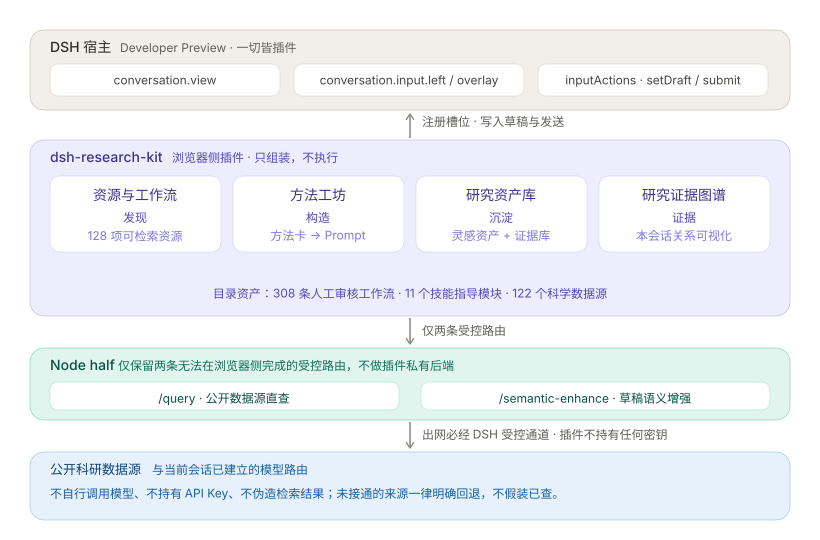
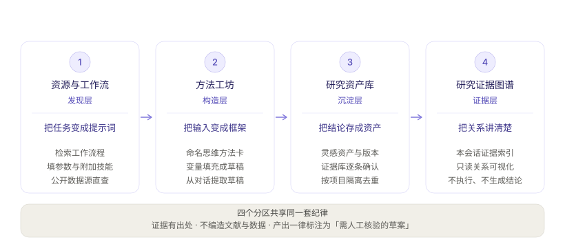
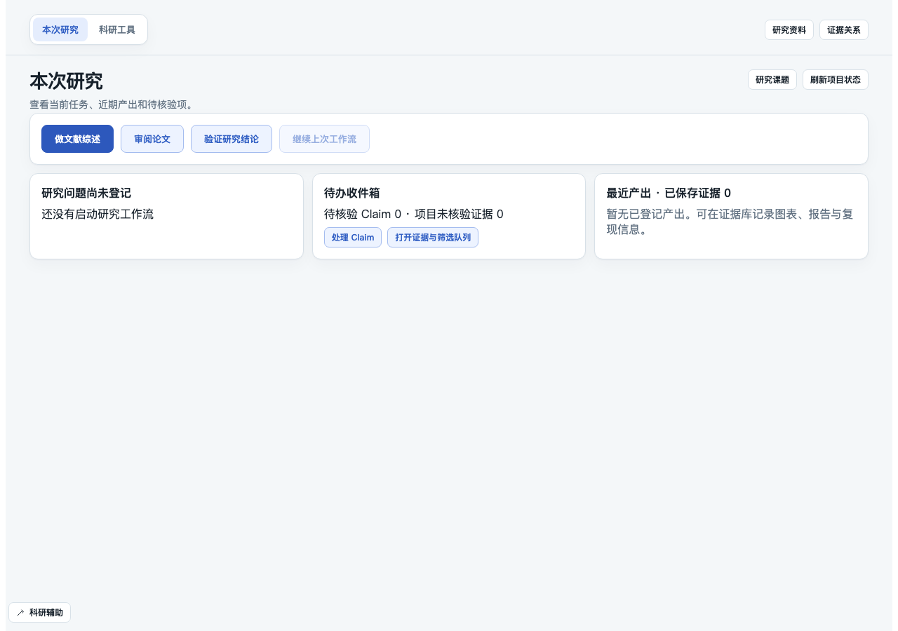
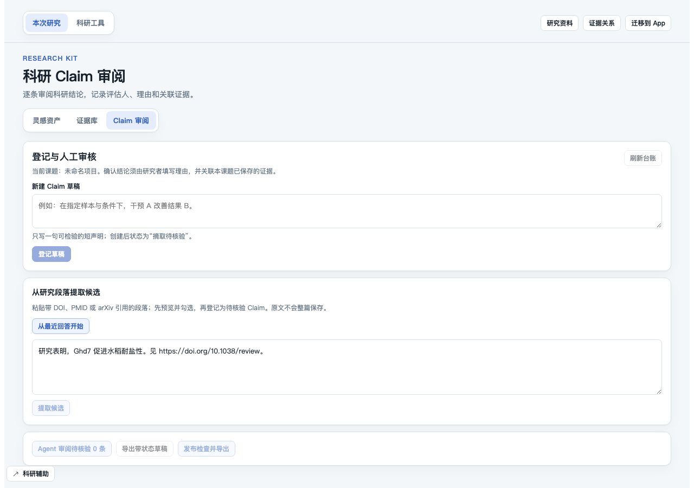
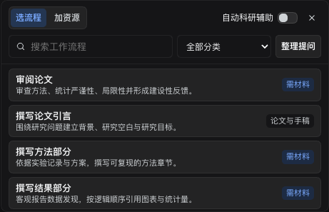
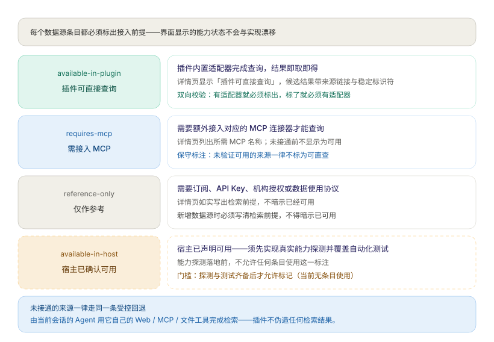

# DSH Research Kit

[](LICENSE)
[](https://github.com/fsrmqi/dsh-research-kit/actions/workflows/ci.yml)
[](https://github.com/topics/dsh-plugin)
[](https://nodejs.org)
[](https://dshhub.org/plugins/fsrmqi/dsh-research-kit)

[简体中文](README.md) · [English](README.en.md)

> 面向 DeepSeek Harness 的科研工作台与跨宿主 MCP 工具集：351 条人工审核的工作流、109 个技能条目、129 个科学数据源，以及 38 个研究工具。

在 DSH 中，它把反复执行的科研任务变成**参数化、可编辑、发送前可见**的提示词；通过独立 stdio MCP Server，它也可向 Codex、Claude Code、Zed 等宿主提供文献检索、证据管理、研究运行与审阅工具。所有研究判断仍需研究者核验。

---

## 前置：什么是 DSH

本项目是 [DeepSeek Harness](https://github.com/deepseek-ai/deepseek-harness)（命令行缩写 `dsh`）的插件。DSH 是 DeepSeek 开源的本地 Agent 工作系统，核心设计理念是「一切皆插件」（Everything is a Plugin）——模型、工具、界面、存储都由可替换的插件组成。

**DSH 工作台需要 DSH；MCP Server 可独立接入兼容宿主。** 项目不自带模型或 API Key；DSH 侧复用当前会话能力，MCP 侧以本地 stdio 服务运行。

| 需要什么 | 去哪拿 |
| --- | --- |
| DSH 本体 | [deepseek-ai/deepseek-harness](https://github.com/deepseek-ai/deepseek-harness) · [官方站点](https://deepseek.com/harness) |
| 插件生态 | [GitHub topic: dsh-plugin](https://github.com/topics/dsh-plugin) |
| Node.js | `>= 22.19`（与 DSH 宿主的 `^22.19.0 \|\| >=24.0.0` 对齐） |

> DSH 目前处于 **Developer Preview**，官方明示会快速迭代、可能出现破坏性变更。本插件依赖的 `conversation.view` 槽位与 `inputActions` 契约随 DSH 版本演进——升级 DSH 后请按[手工验收清单](https://github.com/fsrmqi/dsh-research-kit/blob/main/docs/MANUAL-QA.md)复验。

> **与同类插件共存。** 同一槽位可以注册多个视图，`order` 只决定标签顺序：本插件的科研工作台在 `conversation.view` 的 `order` 是 91，上下文类插件（如 `dsh-context`，`order` 20）可与它同时安装。两者的数据与状态互不共享——本插件不读写其它插件的存储。

## 它解决什么问题

通用聊天输入适合临时提问，但不适合反复执行有明确步骤、材料要求与质量边界的科研任务。审稿、写引言、做综述、设计分析计划这类任务需要四件事：

1. **明确**的输入材料与输出范围；
2. **可复查**的执行步骤，而不是一句笼统指令；
3. **发送前**让研究者看见、编辑并确认任务说明；
4. 对「不编造文献 / 数据 / 结论」的**硬约束**。

Research Kit 把这四点做成可复用的资产。

## 它怎么工作

```text
科研能力目录（589 项）
  → 选择工作流
  → 填写参数、用 @文件 引用材料
  → 预览并编辑最终 Prompt
  → 写入输入框 或 发送到当前会话
  → 由当前 DSH 会话的 Agent 与其已配置工具执行
```



关键设计取舍：

- **不持有模型密钥**。DSH 侧复用当前会话模型路由，MCP 侧不选择或托管模型；
- **不重造文件上传**。材料引用走 DSH 原生 `@文件`；
- **不假装已检索**。数据源条目如实标注接入前提，未接通时明确回退到 Agent/MCP。

## 能力一览

**🧪 351 条人工审核的科研工作流**
覆盖论文与手稿、文献研究、数据分析、基因组学、临床研究、神经科学、生态学、天文与空间科学等 28 个流程族（按分类分片维护于 `catalog/workflows/`）。每条都是参数化、可编辑的 Prompt 模板，内置防编造边界（不得虚构引用、数据、页码、作者意图）与「需人工核验」定位。

**⏲ 限时决策与证据复查**
新增「限时研究决策」和「待核验证据复查提醒」工作流。两者把能力前提写进工作流指令，由当前 Agent 自行判断：限时提问只在 Agent Preset 实际启用 `ask_user_question` 的 timed mode 时调用，超时后只继续可逆且独立的工作；复查提醒只在用户明确确认且 `schedule_create` 实际可用时创建，不可用时输出可复制的提醒正文而不声称已创建。插件本身不探测这两项宿主能力，也不替 Agent 决定是否调用；两条工作流都不会把超时或 pending 当作批准，不会自动发布、删除或晋升研究资产。

**🧩 109 个技能条目：46 个指导模块 + 63 个能力目录**
指导模块以提示词指导方式生效——科学写作、统计审查、引用核验、证据综合、可重复性检查、评审伦理与保密、数据完整性守护、不确定性表达，以及实验设计、假设生成、科学头脑风暴、科学批判性思维、样本量与统计功效、系统文献综述、科研图表、不确定度与单位、临床报告草案、投稿规范核验、同行评审意见、基金申请书撰写等方法模块，另有农业试验设计、作物基因组与育种证据、生信流程治理三个领域模块，勾选后并入工作流提示词；能力目录以「需宿主能力」状态如实收录 bulk RNA-seq、Nextflow、Benchling/DNAnexus 集成、文献 API 检索、docx/pdf 产出等依赖执行侧的技能——写明所需工具链、凭据与数据外发边界，附使用前提核验清单，不注入提示词、不代为执行。

**🔬 129 个科学数据源，其中 11 个支持插件直查**
文献、临床、遗传、组学、蛋白/化学，以及天文空间、生物多样性、气候环境、地理空间。公开 API 可直查并返回带链接与稳定标识符的候选记录；限流、需授权或需专业参数的来源会明确回退到 DSH Agent/MCP。

**✍️ 发送前完整可见、可编辑**
参数替换实时生成 Prompt 预览；手动编辑后参数变更不会静默改写正文，并提供「恢复自动生成」。必填参数缺失时不发送。

**🧭 一个工作台，两个主入口**

| 入口 | 常用操作 |
| --- | --- |
| 本次研究 | 查看当前任务、待核验和最近产出，需要管理归属时打开「研究课题」。通过「研究资料」管理资产、证据与论断，通过「证据关系」追溯关联 |
| 科研工具 | 「选流程」组装科研提示词；「用方法」从对话取材并填充方法卡；「查来源」直接查询或委托 Agent；「我的」维护可重复使用的私人方法和流程模板 |

顶层是上面两个入口；工作台内部由「项目首页」加上发现、构造、沉淀、证据四个分区组成，共用同一套防编造与人工核验纪律。



性能、搜索、证据分页、文献互操作与统一 Claim 台账之外，综述审核记录导出（`links[].evidenceId` 对应候选表 `id`）和论断的按立场证据回查也在 [优化与功能说明](https://github.com/fsrmqi/dsh-research-kit/blob/main/docs/PRODUCT-IMPROVEMENTS.md) 中逐步说明。

**⏱ 组装回放：把 Prompt 是怎么拼出来的放给你看**
启动工作流后，工作台把 `composeWorkflow` 的**真实组装事实**逐段回放——工作流 → 参数 → 附加技能 → 数据源边界 → 人工核验；每一段都能在生成的 Prompt 文本中定位到对应锚点，回放与正文互相印证。详情栏内嵌紧凑回放，「弹出回放窗口」打开独立的 archify 交互 viewer（四种视觉预设、章节叙事、语义透镜、雷达总览）。回放只呈现**已经发生的组装动作**，不预测执行结果，也不代表 Agent 已执行任何工具；`prefers-reduced-motion` 时降级为静态。

`research_run_export` 还会返回 `release_evidence`：这是一个不含本机路径或护照正文的运行快照引用，带 run ID 与内容哈希，可供其他受控资产系统关联发布记录。它的 `verification_status="snapshot_exported"` 只表示护照已导出，**不是**研究结论、工作流或 Skill 的验证通过凭据；发布高影响资产仍须另附真实任务验证证据并经过人工确认。

**科研 Claim 与 Context Pack**：MCP 新增显式 Claim 台账。每条 Claim 必须带认识论状态：`extracted`、`inferred`、`ambiguous`、`verified` 或 `rejected`；只有人工提供证据 ID、操作人和评估理由才能写成 `verified`。`research_run_checkpoint_approve` 可附带验证回执，而 `research_context_pack` 只投影 Claim、证据元数据与人工回执，要求用户审阅后再选择注入，绝不把未确认结论改写为事实，也不携带论文全文、笔记或检索词。

**Claim 审阅面板**：研究资产库的「Claim 审阅」子模块直接读取同一份 MCP Claim 台账。可从带 DOI、PMID、arXiv 引用的研究段落提取候选，逐条勾选后登记为 `extracted`，并保留短引用锚点；也可手工登记。使用当前会话模型的「Agent 审阅」会生成独立的状态建议和理由，不改变人工状态。研究者再逐条确认／存疑／驳回、填写评估人和理由并关联当前课题已保存的证据。卡片上的「查看证据关系」按支持、反驳、证据不足、待评估四种立场回查来源，并列出已记录的原文位置、逐条评估人与来源核验状态，可直接打开原文；无关联的论断会提示补充来源。草稿导出保留状态；发布导出遇到未人工确认或证据缺失的 Claim 会给出阻断清单。界面与导出只携带证据元数据，不含笔记或全文。

<details>
<summary><strong>更多能力</strong>（点击展开）</summary>

- **科研模式任务预设** — 一键选择：**通用研究、文献与论文、生物信息学、作物遗传育种、临床与人群研究、数据分析与可视化**。每项会附加相应的技能组合与研究纪律（例如流程版本与质控留痕、农业试验和 G×E 边界、隐私与偏倚、统计前提与图表可解释性）；预设只是"指导组合"，不会自动执行任何工具。
- **输入框快捷入口** — 点击「科研辅助」可选流程、加资源或整理当前提问。浮层顶栏的自动科研辅助默认关闭，仅作用于当前会话。开启后可根据草稿、材料数量及明确续接时的最近一条提问给出短版科研建议，确认后插入草稿。同一开关会在符合条件的回答旁提示可保存的内容，勾选确认后才入库。
- **草稿增强器** — 从「科研辅助 → 整理提问」打开：轻量档（零 Token 结构化整理）与语义档（复用当前会话模型、流式上屏、五维诊断、可取消），强度三档；增强后可撤销、可对比原稿。选中文本时只替换选区，异步期间草稿变动则拒绝写入；含 `@` 引用 chip 的选区因坐标不一致会提示改用整稿增强。语义档可勾选「项目记忆」检索宿主接入的 Memory Center MCP（检索 → 来源预览 → 用户勾选 → 组装，默认关闭、禁止静默注入）。 入口形态可在 Plugins 详情页「运行状态」里切换：**输入框内**（默认）或**悬浮伴生钮**（可拖拽、位置记忆，附带沉淀伴生圆钮）——改完即时生效，无需重启。
- **宿主能力探测** — 数据源详情展示一行部署级事实：装配了 Web / Shell / 文件系统 / 模型路由中的哪些，以及实际连接了哪些 MCP 服务器（从工具注册表解析，有界截断）。只陈述事实，不推断某数据库可用，不改写目录标注。
- **手动沉淀** — 通过助手回答下方的操作区打开该条回答的预览，即可勾选后保存。
- **回答依据** — 从已完成的回答打开预览，逐条核对结论、对应论文、图表或小节及缺失材料。勾选并确认后，所选内容以待核验状态写入图谱、证据库及灵感资产。图谱详情可回看已保存的原文位置并打开论文。
- **研究工具执行态** — DSH 工具卡显示准备中的参数摘要、执行中状态与失败原因；完成后展示 DOI、来源、已记录等级和建议等级。
- **安全草稿插入** — 支持新版 DSH `captureInsertion()` / `insertText()` 契约的异步结果会插入光标处，并校验草稿修订；宿主不支持时才回落到整草稿写入。草稿已被用户改过时，插件会提示手动粘贴，而不是覆盖新内容。
- **插件页运行状态** — Plugins 页的 Research Kit 详情下展示 Web / Shell / FS / LLM 装配事实、实际连接的 MCP 服务器与直查适配器数量；标题旁的规模徽章给出构建期烘焙的工作流 / 技能 / 数据源数量（不做运行时探测，避免先闪 0 再跳数），头部「复制诊断」按钮把插件版本、目录规模与上述探测结果一次性写入本机剪贴板（不上传、不含会话内容）。头部另有「回到会话」按钮：一次点击把主区切回当前会话；该会话此前停在科研工作台时会一并恢复该视图（视图标签由宿主会话状态决定，跨页没有公开的选中入口）。它只报告部署事实，不会把某条数据源改标为已验证可用。
- **即时查询配置** — `memoryServer`、`memoryTimeoutMs`、`databaseTimeoutMs`、`databaseRequestsPerMinute` 和 `allowAgentFallback` 是 volatile Config 字段，可在插件页修改并在下一次请求生效；默认值分别对应 Memory Center、15 秒、15 秒、每分钟 12 次和允许 Agent 回退。
- **收藏与使用历史** — 列表条目一键星标；成功写入/发送/复制自动记入历史（本地仅存 ID、名称、首行摘要与时间，最多 20 条）。
- **研究证据库** — 公开数据源查询结果可逐条「保存到证据库」，条目带稳定标识符（DOI / PMID / NCT / arXiv）与来源链接，默认「未核验」；按项目隔离去重，可导出 / 导入 JSON 与彻底删除。**只保存来源元数据与你写下的笔记，不保存全文与检索词；默认不自动入库。通过回答预览确认保存后，引用来源以「未核验」状态入库。**证据库还提供「一键用 Agent 判断」：默认只处理未人工评估条目，可勾选包含人工处理过的条目重新取得当前会话模型的最新初判；Agent 判断与人工评估分开保存并保留历史，不会自动推进核验状态。该按钮只把标题、链接、标识符、保存原因和笔记发送给模型，不读取来源全文，结果必须人工核验。**
- **研究证据图谱** — 把本会话的资源、工作流、查询来源、灵感资产与**已保存证据**连成可追溯关系；证据节点只带来源库 / 稳定标识符 / 核验状态，**不展示笔记或检索词**；箭头表示关系方向，逆向关系按两端实际位置取锚点而非固定「左进右出」。确定性分层布局，支持 Ctrl / ⌘ 滚轮缩放、拖拽平移与复位，迷你地图快速跳转，聚焦 / 上游 / 下游 / 两点路径四种范围模式；可复制只含视图状态的链接，可导出脱敏 SVG / HTML 快照（导出前明确提示元数据范围）。
- **回答沉淀** — 开启当前会话的「自动科研辅助」后，符合条件的新回答会提示可保存的结论和来源。选择并确认后，知识进入图谱、灵感资产及证据库，全部按待核验记录，支持回看回答摘录、按课题筛选及备份。
- **自动多标签与主题分组** — 新沉淀的灵感资产和引用证据会按本地受控词表写入内容类型、可并存的研究主题及来源类型标签；两个库默认按首个匹配主题分组，可切回平铺列表并搜索主题标签。旧条目在列表中即时推导主题，不批量改写原有数据或人工标签；未命中的条目归入「待归类」。分类只帮助整理，不代表事实核验，标签仍可人工编辑。
- **研究结果解释图** — 目录内置「研究结果解释图生成」工作流：把研究结果整理成 diagram IR，再由 `scripts/render-diagrams.mjs --html` **确定性**产出单文件交互 HTML（可直接分享、离线打开），`--from-files` 可从会话产出文件生成 IR 脚手架；`scripts/validate-diagrams.mjs` 提供机器可读的规则诊断并已进入 `npm run check`（仓库内不预置 IR 文件，该校验在产出 / 审阅 IR 时生效）。
- **资产-证据互链** — 灵感资产卡可展开「关联证据」：按同项目、共同标签与自动沉淀的知识链推导候选，**勾选确认后才建立**（绝不自动建边）；证据条目反查「被引用于」哪些资产；图谱画出「资产 → 支撑证据」边（随「持久沉淀」范围收敛，端点删除自然剔除）。关联关系已随证据库 JSON 备份与完整备份导出，完整备份导入时自动跳过缺失资产或证据端点的记录。
- **多种 Prompt 出口** — 写入输入框、发送到会话之外，还有「复制 Prompt」兜底：宿主动作缺失时也能把提示词带去任意会话。
- **启动前必填校验** — 预览弹窗内字段级错误提示（红框 + 说明）；缺失必填项不会写入草稿。
- **资源选择可管理** — 弹层底部实时显示已选资源 chip，可单个移除或清空。
- **手动编辑保护** — 手动编辑后变更参数/技能会提示不会自动合并；筛选后详情始终属于当前结果集。
- **宿主动作降级** — `setDraft`/`submit` 缺失时按钮禁用、灰化并说明原因，视图不崩溃。
- **MCP 工具集与阶段确认** — 插件同时提供 MCP Server：38 个 `research_*` 工具（文献检索与核验、证据盘点与人工评估、显式 Claim 台账与发布检查、科研 Context Pack、多面板图表生成、声明/异常/写作审阅、AI 披露生成、运行状态与检查点审批），宿主 Agent 可直接调用而无需经过 UI；调用轨迹在 DSH 的活动中查看，科研阶段确认在「本次研究」的待办收件箱处理。研究运行护照支持导入/导出以跨会话恢复。完整工具清单与接入方式见 [MCP Server 跨平台配置指南](https://github.com/fsrmqi/dsh-research-kit/blob/main/docs/MCP-SETUP.md)。

**深色主题与窄屏** — 跟随系统与 DSH 主题切换；880px 以下单列布局；原生 `aria-*` 与焦点环。

</details>

## 安装

要求 Node `>= 22.19`（DSH `0.2.2` 线宿主自身要求 Node `>= 24.9`），以及提供 `conversation.view` / `conversation.input.left` / `conversation.input.overlay` / `conversation.input.right` 四个槽位的 DSH Web profile（依次为：统一视图、输入框左侧入口、浮层选择器、输入框右侧草稿增强器）。Plugins 页的规模徽章、诊断复制与运行状态区另用 `plugins.detail.badge` / `plugins.detail.actions` / `plugins.detail.section`；宿主未提供这些槽位时只是不显示，不影响会话内功能。详情页的「回到会话」走宿主的公开会话导航面（`uiWorkspace.openSession`，DSH `0.1.7` 起即有；再尽力用 `uiConversation.binding(id).activate(view)` 激活视图数据源）。**它只保证把主区切回当前会话**：视图标签由宿主会话状态决定，此前停在科研工作台时会一并恢复，否则落在默认对话视图（宿主没有跨页选中视图的公开入口）。工作台的「在新会话开始」需要 DSH `0.2.1-rc.1` 起的草稿预填通道（`startSession` 的 `prompt` + `conversation.input.requestDraftInitialization`；`whenDraftExists` 语义自 `0.2.1-rc.3` 起），`0.1.7` / `0.2.0` 线与更早宿主上该入口不渲染。支持的 DSH 版本由 `engines.dsh`（宿主优先读取）与 `peerDependencies` 共同声明为 `>=0.1.7-0 <0.1.8-0 || >=0.2.0-0 <0.2.3-0`；兼容性矩阵的基线覆盖至 `0.2.2-rc.5`（清单见 `scripts/lib/dsh-baselines.mjs` 与 [COMPATIBILITY.md](https://github.com/fsrmqi/dsh-research-kit/blob/main/docs/COMPATIBILITY.md)）。`npm run check:dsh-app -- <dsh 仓库>` 会逐基线核对导航 seam，接线契约由 `npm test` 看守。

**本地目录（当前推荐，尚未发布到 npm）**

```bash
git clone https://github.com/fsrmqi/dsh-research-kit.git
dsh plugin --profile web add ./dsh-research-kit
```

**GitHub（钉 commit，可复现安装）**

```bash
dsh plugin --profile web add github:fsrmqi/dsh-research-kit#<commit-sha>
```

**tarball（离线 / 审计）**

```bash
npm pack && dsh plugin --profile web add ./dsh-research-kit-0.3.3.tgz
```

> 构建产物 `ui/client.js`、`ui/catalog-data.json` 与 `ui/promptkit.js` 已提交到仓库——克隆后即可安装，无需本地构建。

安装后刷新浏览器，在会话中打开「科研工作台」，或使用输入框旁的「科研辅助」入口。卸载或关闭视图不会残留重复注册。

## 可组合运行预设

`presets/` 提供只覆盖 Research Kit 配置行的启动 overlay：[`research-direct.patch.yml`](presets/research-direct.patch.yml) 禁用 Agent 回退并收紧公开数据库直查的超时与速率；[`research-assisted.patch.yml`](presets/research-assisted.patch.yml) 保留默认的 Agent 回退。它们可与 Memory Center 的隐私 overlay 一同按顺序传给 `dsh --profile web --patch …`；每份文件都重述本插件的完整 `config`，不会意外继承已被其他 patch 替换的字段。已加载插件时，也可在 Plugins 页的 Research Kit 配置区分别点「直连研究」「Agent 辅助」两行右侧的「应用」按钮：一次有修订号保护的配置写入应用同一组字段，不会修改 profile 之外的设置。

**常见坑**：`dsh plugin` 会调用 PATH 上的 `pnpm`，其 store 布局主版本必须与目标 profile 记录一致，否则会以 `ERR_PNPM_UNEXPECTED_STORE` 失败。对照方式见[手工验收清单 §1](https://github.com/fsrmqi/dsh-research-kit/blob/main/docs/MANUAL-QA.md)。

## 使用

有两条入口，通往同一套目录资产。

**界面渲染图（浏览器回归实测）**：下列三张由 `npm run test:browser` 在真实 Chromium 中渲染插件构建产物得到；宿主服务是测试桩（模拟会话、模拟工具数据与本地 HTTP 路由），因此只反映本插件的界面布局与交互入口，不代表真实 DSH profile 的会话外壳，也不含真实研究数据。







**待补真实截图**：目前尚无经真实 profile 验收的界面截图，下表位置不以占位图或合成界面替代；补齐时按列中要求取材并替换上面的浏览器回归图。

| 位置 | 图片要求 |
| --- | --- |
| 首屏工作台 | 真实 DSH Web profile 中的科研工作台首页，宽度 ≥ 1280px，同时出现宿主会话标签栏与「本次研究 / 科研工具」入口；不得来自测试桩 |
| 工作流预览弹窗 | 真实 Web profile 中「选流程 → 预览」状态，展示参数、Prompt 正文与「写入输入框 / 发送到当前会话」按钮；稿件与参数须脱敏 |
| Claim 审阅与证据关系 | 真实 Web 或 Desktop profile 中至少一条经人工确认的 Claim 及其按立场分组的证据关系；评估人、理由、状态须为研究者真实填写，不得使用测试桩的 `qa-claim-*` 数据 |
| 证据图谱 | 真实 profile 中含至少一条「资产 → 支撑证据」边的图谱视图；节点题名与 DOI 须可公开或已脱敏 |

**方式一：科研工作台统一视图**

1. 在会话中打开「科研工作台」，默认进入「本次研究」，可选择综述、审稿、结论验证或继续上次工作流。进入「科研工具」按任务选流程、用方法或查来源，可搜索或按类型筛选 589 项资源；
2. 选择工作流，查看目的、所需材料与使用限制；
3. 填写参数；需要材料的工作流请先在 DSH 输入框用 `@文件` 引用文件；
4. 按需勾选「附加技能指导」，预览实时更新；详情栏可展开**组装回放**，逐段核对 Prompt 是怎么拼出来的；
5. 点「写入输入框」保留再次编辑的机会，或「发送到当前会话」直接执行。

**方式二：输入框快捷入口**

1. 在输入框工具行点击「科研辅助」，在输入卡片上方选择「选流程」或「加资源」；
2. 「选流程」面板：按场景筛选并选择流程，在预览弹窗中填写参数、检查 Prompt，点「使用工作流程」写入草稿；
3. 「资源」面板：在全部/数据库/技能之间勾选，勾选的技能作为附加指导、数据库作为研究提示并入之后启动的工作流；
4. 写入后用 DSH 原生回形针或 `@文件` 补充材料，再自行发送——快捷入口**只写草稿，从不自动发送**。

真实发送由 DSH 完成；本插件不创建模型路由、不保存密钥、不读取文件内容。

## 目录内容

工作流按流程族分片维护于 `catalog/workflows/`（每分类一个 JSON 分片，由 `index.js` 按固定顺序聚合）：

| 分类（分片） | 条数 |
| --- | --- |
| 论文与手稿（paper-manuscript） | 17 |
| 文献研究（literature） | 16 |
| 数据分析（data-analysis） | 18 |
| 研究设计（research-design） | 5 |
| 生物信息学（bioinformatics） | 18 |
| 基因组学（genomics） | 14 |
| 临床研究（clinical） | 19 |
| 作物遗传育种（crop-breeding） | 8 |
| 可视化与图表（visual） | 13 |
| 科研传播（science-communication） | 10 |
| 基金申请（grants） | 10 |
| 蛋白组与结构生物学（proteomics） | 13 |
| 细胞生物学（cell-biology） | 9 |
| 化学（chemistry） | 18 |
| 药物发现（drug-discovery） | 15 |
| 材料科学（materials） | 12 |
| 神经科学（neuroscience） | 12 |
| 生态学（ecology） | 14 |
| 物理学（physics） | 14 |
| 天文与空间科学（astronomy） | 11 |
| 社会科学（social-science） | 12 |
| 数学（mathematics） | 12 |
| 机器学习（machine-learning） | 15 |
| 工程学（engineering） | 12 |
| 高级工作流（advanced） | 9 |
| 深度研究（deep-research） | 9 |
| 论文写作（paper-writing） | 11 |
| 投稿规范（submission） | 5 |

另有 109 项技能（`catalog/skills/`：core 43 / crop-breeding 2 / bioinformatics 1 / host-capabilities 63）与 129 个数据源条目（`catalog/resources/`：chinese-academic 7 / crop-breeding 7 / literature 19 / genomics 8 / omics 7 / general-science 81）。完整定义见 [`catalog/`](catalog/)，数据契约见[架构文档 §4](https://github.com/fsrmqi/dsh-research-kit/blob/main/docs/ARCHITECTURE.md)。

## 隐私与安全

在 DSH Desktop 中，打开「科研工作台 → 本次研究 → 时空囊」导出本地完整备份。换电脑、重装或重建配置后，可从同一入口预览并增量恢复。以往的迁移包也可在这里打开。详见 [本地备份与恢复](https://github.com/fsrmqi/dsh-research-kit/blob/main/docs/APP-MIGRATION.md)。

| 访问 | 用途 | 说明 |
| --- | --- | --- |
| 当前会话输入框 | 仅在点击「写入/发送」时写入或提交最终 Prompt | 不拦截 Enter，不自动发送，不改动其他会话历史 |
| `@文件` 引用 | 只提示你使用 DSH 原生提及 | 不读取、不上传、不解析文件内容 |
| 浏览器本地 | 收藏、使用历史、方法卡与灵感资产（`localStorage`） | 不存参数值、完整 Prompt、文件内容；清除浏览器数据即清空 |
| 浏览器 IndexedDB | 证据库条目：来源元数据与你主动写下的笔记 | **仅在你逐条确认保存后**写入；不保存全文、检索词与原始响应；按项目隔离，可导出 / 导入 / 彻底删除。证据图谱只展示其中的来源库 / 标识符 / 核验状态，不展示笔记 |
| 当前页面内存 | 本会话证据索引（已启动工作流、直查来源摘要） | 仅供工作台各分区实时形成证据图谱；刷新或关闭页面即清空，不保存检索词、原始文件或完整结果 |
| 网络 | 公开数据源直查（仅在你主动触发时） | 出网经 DSH 受控 web 服务；插件不持有任何 API Key |

**零遥测。** 不上传使用统计，不采集数据。所有工作流产出一律标注为**需人工核验的草案**，不替代研究者、审稿人或伦理审批。

安全边界与漏洞上报方式见 [SECURITY.md](SECURITY.md)。

### 数据库查询

数据源详情页可直接查询首批公开来源：PubMed、Crossref、OpenAlex、Semantic Scholar、Europe PMC、ClinicalTrials.gov、openFDA、UniProt、PubChem、GBIF、iNaturalist——这 11 个来源在目录里标记为 `available-in-plugin`，详情页状态显示「插件可直接查询」。候选结果显示来源链接与稳定标识符，可写入输入框，或显式点击「让 Agent 核验并继续查询」——该按钮会调用当前 DSH 会话的 Agent，由它使用自己已拥有的 Web / MCP / 文件工具完成多步检索。

其余 118 个数据源标记为 `requires-mcp` 或 `reference-only`，会清楚提示所需的 MCP、订阅、API Key 或数据使用协议，并提供同一受控 Agent 回退。目录标注与查询实现由 `npm run check` 双向校验（有适配器就必须标出来，标了就必须有适配器），因此界面上的能力状态不会与实现漂移。**插件不会伪造任何检索结果。**

四档标注各自的界面行为与保证机制：



## 兼容性与状态

当前版本 `0.3.3`（尚未发布到 npm）。开发状态与下一步计划见 [ROADMAP.md](ROADMAP.md)。

已通过的验证：目录契约校验（589 项、589 唯一 ID，分片与聚合入口逐条一致）、642 项回归测试（80 个测试文件，含 7 项宿主动作缺失的渲染级降级断言、14 个基线 tag 的宿主契约矩阵与「客户端/Desktop App 共用同一份产物」的形态守卫）；既有 Web 功能曾在真实 DSH Web profile 完成两轮启动烟测。完整备份的导出和预览已在真实 Desktop profile 验收，增量恢复仍待隔离 Desktop profile 验收。

> 真实 profile 验收无法被单元测试替代——`test/dsh-slots.test.js` 虽然执行真实构建产物，但 slots 服务是模拟的。因此升级 DSH 后必须重跑[手工验收清单](https://github.com/fsrmqi/dsh-research-kit/blob/main/docs/MANUAL-QA.md)。

## 开发

```bash
npm run build   # 生成 ui/client.js、catalog-data.json 与 promptkit.js（提交产物，勿手改）
npm run check   # 目录契约校验 + 语法检查
npm test        # 纯逻辑、契约与渲染级回归测试（642 项 / 80 个测试文件）
npm run test:browser  # 真实 Chromium 交互回归（首次需 npx playwright install chromium）
```

改动 `catalog/`、`src/` 或 `dsh/` 后统一执行 `npm run build && npm run check && npm test`；CI 会校验构建产物与源码同步（构建后有 diff 即失败）。本地要一次跑完 CI 的门禁序列（含宿主契约矩阵与覆盖率棘轮）用 `npm run verify`。

## 文档

| 文档 | 内容 |
| --- | --- |
| [docs/README.md](https://github.com/fsrmqi/dsh-research-kit/blob/main/docs/README.md) | **文档索引与推荐阅读顺序**（含配图索引） |
| [论文工作手册](https://github.com/fsrmqi/dsh-research-kit/blob/main/docs/PAPER-WORKFLOW.md) | 从选题、检索到投稿：九阶段单点工作流表、十阶段八闸门一键流水线、三条查询路径、投稿包清单与 MCP 操作链 |
| [MCP Server 接入指南](https://github.com/fsrmqi/dsh-research-kit/blob/main/docs/MCP-SETUP.md) | 把 38 个 `research_*` 工具接进 Codex / Claude Code / Zed / DSH，含按任务组织的最短路径与参数示例 |
| [架构与数据契约](https://github.com/fsrmqi/dsh-research-kit/blob/main/docs/ARCHITECTURE.md) | 模块职责、数据流、DSH 宿主边界、目录 schema |
| [开发指南](https://github.com/fsrmqi/dsh-research-kit/blob/main/docs/DEVELOPMENT.md) | 本地启动、实现顺序、测试策略、交付检查单 |
| [手工验收清单](https://github.com/fsrmqi/dsh-research-kit/blob/main/docs/MANUAL-QA.md) | 为什么不能用单测替代、逐项验收步骤、失败定位树 |
| [方法工坊嵌入设计](https://github.com/fsrmqi/dsh-research-kit/blob/main/docs/METHOD-WORKSHOP.md) | vendored 工件治理、命名空间纪律、构建器集成规则 |
| [范围与边界](https://github.com/fsrmqi/dsh-research-kit/blob/main/docs/PRODUCT.md) | 要解决的问题、产品边界、质量与安全原则 |
| [优化与功能说明](https://github.com/fsrmqi/dsh-research-kit/blob/main/docs/PRODUCT-IMPROVEMENTS.md) | 综述恢复、证据分页、文献互操作、Claim 审核与按立场证据关系 |
| [兼容性矩阵](https://github.com/fsrmqi/dsh-research-kit/blob/main/docs/COMPATIBILITY.md) | 支持的 DSH 基线、宿主契约 seam 与 CI 看守方式 |
| [本地备份与恢复](https://github.com/fsrmqi/dsh-research-kit/blob/main/docs/APP-MIGRATION.md) | 本地完整备份、恢复流程与兼容边界 |
| [变更记录](CHANGELOG.md) | 按版本的可追溯变更与工具改名对照 |

## 参与贡献

欢迎 Issue 与 PR——见 [CONTRIBUTING.md](CONTRIBUTING.md)。新增工作流只需在 `catalog/workflows/<分类>.json` 分片中按现有条目结构添加 JSON 对象并运行 `npm run check && npm test`；契约校验器会强制检查占位符一致性与防编造边界，并断言分片与聚合入口逐条一致。

## 许可证

[MIT](LICENSE)。

随仓库分发的 vendored 工件的第三方归属与许可证声明见 [NOTICE](NOTICE)。
